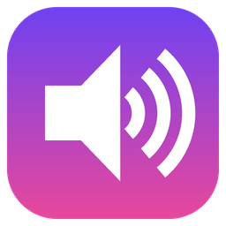

# MySoundpad

โปรแกรม soundboard สำหรับ Windows เล่นเสียงเข้าไมโครโฟน ให้เพื่อนใน Discord หรือในเกมได้ยิน พร้อมปุ่มลัดที่กดได้แม้กำลังเล่นเกมอยู่ ใช้งานฟรี ไม่มีจำกัดเวลา

---

## ✨ ความสามารถ

### เล่นเสียง
- 🎙 **เล่นเสียงเข้าไมค์**: ส่งเสียงไปที่ไมค์เสมือนผ่าน [VB-CABLE](https://vb-audio.com/Cable/) คนใน Discord หรือในเกมจะได้ยิน
- 🎧 **ฟังเองพร้อมกัน**: เล่นออกหูฟังของเราไปพร้อมกัน ปรับความดังแยกจากฝั่งไมค์ได้
- 🎤 **ส่งเสียงพูดผ่านไปด้วย**: ผสมเสียงไมค์จริงเข้าไปกับเสียงเอฟเฟกต์ เพื่อนได้ยินทั้งเสียงพูดและเสียงเอฟเฟกต์
- 🔊 **เล่นซ้อนกันหลายเสียง** หรือตั้งให้หยุดเสียงเก่าเมื่อเล่นเสียงใหม่ก็ได้
- 🛡 **Soft limiter**: กดเสียงที่ดังเกินให้นุ่มลง ไม่แตก
- รองรับไฟล์ **mp3, wav, ogg, flac, aiff**

### ปุ่มลัด
- ⌨ **ปุ่มลัดแบบ global**: กดได้แม้กำลังอยู่ในเกมหรือโปรแกรมอื่น
- ตั้งได้ทีละเสียง รองรับคีย์ผสม เช่น **Alt+1, Ctrl+2, Ctrl+Alt+3, Ctrl+Shift+F, Ctrl+Num5** รวมถึง F1–F24 และ Numpad
  - ใช้ปุ่ม **Win** ไม่ได้ เพราะ Windows ใช้อยู่แล้ว (เช่น Win+1 เปิดแอปตัวแรกบน taskbar)
  - **Shift+Numpad** ใช้ไม่ได้ เพราะเมื่อเปิด NumLock อยู่ Windows จะปล่อยปุ่ม Shift ให้เอง ให้ใช้ Ctrl หรือ Alt+Numpad แทน
- มีปุ่มลัด **หยุดทุกเสียง** (ค่าเริ่มต้นคือ Pause)
- ปิดปุ่มลัดชั่วคราวได้ เช่น ตอนพิมพ์แชท

### YouTube
- 🎬 **ดาวน์โหลดเสียงจาก YouTube**: วางลิงก์ (รองรับ Shorts) แล้วเสียงจะเข้ารายการให้อัตโนมัติ
- ✂ **ตัดช่วงด้วยหลอดเลื่อน 2 หมุด**: ลากเลือกตั้งแต่ตรงไหนถึงตรงไหน ปรับละเอียดได้ทีละ 0.1 วินาที และซูมเข้าช่วงที่เลือกได้
- 🎧 **ฟังตัวอย่างก่อนตัด**: ฟังช่วงที่เลือก / 3 วิแรก / 3 วิสุดท้าย และกด `[` `]` ตั้งจุดตอนที่ได้ยินท่อนที่ต้องการ เสียงตัวอย่างออกหูฟังอย่างเดียว เพื่อนไม่ได้ยิน
- 🌐 **โหมดสตรีม**: เล่นตรงจาก YouTube โดยไม่เก็บไฟล์ในเครื่อง ใช้ RAM คงที่แม้คลิปยาวเป็นชั่วโมง
- ⬆ **อัปเดตตัวโหลดในโปรแกรม**: ตรวจ SHA-256 กับไฟล์ทางการก่อนใช้ทุกครั้ง

### อื่นๆ
- 💾 บันทึกรายการเสียง ปุ่มลัด และการตั้งค่าอัตโนมัติ
- 🔍 ค้นหาเสียงตามชื่อ
- 🪶 เบา: ใช้ CPU ต่ำกว่า 0.5% และ RAM ประมาณ 70 MB
- 🧪 มีโหมดตรวจตัวเอง (`--selftest`) ไว้หาสาเหตุเวลามีปัญหา

---

## 💻 ความต้องการของระบบ

| | |
|---|---|
| ระบบปฏิบัติการ | Windows 10 / 11 (64-bit) |
| ไมค์เสมือน | [VB-CABLE](https://vb-audio.com/Cable/) (ฟรี) ถ้าไม่มี จะเล่นเสียงออกลำโพงได้อย่างเดียว |
| อินเทอร์เน็ต | ใช้เฉพาะฟีเจอร์ YouTube |

---

## 📥 วิธีติดตั้ง

### ขั้นที่ 1: ติดตั้ง VB-CABLE (ทำครั้งเดียว)
1. ดาวน์โหลดจากเว็บทางการ **https://vb-audio.com/Cable/** เท่านั้น อย่าโหลดจากเว็บอื่น
2. แตกไฟล์ zip แล้ว**คลิกขวาที่ `VBCABLE_Setup_x64.exe` → Run as administrator**
3. กด **Install Driver** แล้วรอจนติดตั้งเสร็จ
4. **รีสตาร์ทเครื่อง**
5. ถ้าหลังรีสตาร์ทเสียงในเครื่องหายไป ให้คลิกไอคอนลำโพงที่มุมขวาล่าง แล้วเลือกกลับไปเป็นลำโพงหรือหูฟังของคุณ

### ขั้นที่ 2: ติดตั้ง MySoundpad
1. ดาวน์โหลด **`MySoundpad-Setup-x.x.x.exe`** จากหน้า [Releases](https://github.com/inkza1150za/MySoundpad/releases)
2. เปิดไฟล์ ถ้าขึ้น **"Windows protected your PC"** ให้กด **More info → Run anyway**
   > โปรแกรมไม่มีใบรับรองการเซ็นโค้ด (code signing) Windows จึงเตือนแบบนี้กับโปรแกรมที่ยังไม่รู้จัก
3. ทำตามขั้นตอนในตัวติดตั้ง **ไม่ต้องใช้สิทธิ์แอดมิน**
   - ถ้ายังไม่ได้ติดตั้ง VB-CABLE ตัวติดตั้งจะเตือนและให้ลิงก์ดาวน์โหลด
4. เปิด **MySoundpad** จาก shortcut บนเดสก์ท็อปหรือ Start menu

### ขั้นที่ 3: ตั้งค่า Discord หรือเกม (ทำครั้งเดียว)
**Discord:** User Settings → Voice & Video
| ตั้งค่า | ค่าที่ใช้ |
|---|---|
| Input Device | **CABLE Output (VB-Audio Virtual Cable)** |
| Noise Suppression | **None** (ไม่อย่างนั้นเพลงจะถูกตัดจนจมหรือขาดๆ หายๆ) |
| Echo Cancellation | **ปิด** |
| Automatic Gain Control | **ปิด** |
| Input Sensitivity | ปิดโหมดอัตโนมัติ แล้วลากแถบไปทางซ้ายเกือบสุด |

**เกม:** ตั้งไมค์ในเกมเป็น **CABLE Output** แบบเดียวกัน

ทดสอบ: ใน Discord หน้า Voice & Video กด **Let's Check** แล้วลองพูดและกดเล่นเสียง

---

## 🎮 วิธีใช้

### อุปกรณ์เสียง (กรอบซ้ายล่าง)
| ช่อง | ควรเลือก |
|---|---|
| 🎧 ลำโพง/หูฟัง | หูฟังของคุณ แบบ **[MME]** |
| 🎙 ไมค์เสมือน | **CABLE Input [MME]** (ปกติโปรแกรมเลือกให้เอง) |
| 🎤 ไมโครโฟนจริง | ไมค์ที่คุณพูดใส่ แบบ **[MME]** |

> แนะนำให้เลือกแบบ **[MME]** เพราะเข้ากันได้ดีที่สุด

### เพิ่มและเล่นเสียง
| ทำอะไร | วิธี |
|---|---|
| เพิ่มไฟล์หรือโฟลเดอร์ | ปุ่ม **➕ เพิ่มไฟล์** / **📁 เพิ่มโฟลเดอร์** |
| เล่น | ดับเบิลคลิก, กด Enter หรือปุ่ม **▶ เล่น** |
| หยุดทุกเสียง | ปุ่ม **■ หยุด** หรือปุ่ม **Pause** |
| ตั้งปุ่มลัด | เลือกเสียง → **⌨ ตั้งปุ่มลัด** → กดคีย์ที่ต้องการ (Esc = ยกเลิก) |
| เปลี่ยนชื่อ / ลบ | **✏ เปลี่ยนชื่อ** / **🗑 ลบ** (ไฟล์จริงไม่ถูกลบ) |

> 💡 แนะนำให้ตั้งปุ่มลัดเป็น **Numpad 0–9** เพราะไม่ชนกับปุ่มในเกม และต้องเปิด NumLock ไว้

### จาก YouTube
1. คัดลอกลิงก์ แล้วกด **🎬 จาก YouTube** ลิงก์จะถูกวางให้อัตโนมัติ และโปรแกรมจะโหลดชื่อกับความยาวคลิปมาให้
2. **เลือกช่วงที่จะตัด** (ไม่ตัดก็ได้ จะได้ทั้งคลิป)

   ```
             เริ่ม 1:23.0              จบ 1:30.0
                 ▼                        ▼
   0:00 ├────────◆████████████████████████◆──────────┤ 3:45
                            │ ← ตำแหน่งที่กำลังฟัง
   ```
   | ทำอะไร | ผล |
   |---|---|
   | ลากหมุด ◆ ซ้าย / ขวา | เลื่อนจุดเริ่ม / จุดจบ ปล่อยแล้วจะเล่นให้ฟังทันที |
   | ลากแถบสีระหว่างหมุด | ย้ายทั้งช่วง ความยาวเท่าเดิม |
   | คลิกที่ไหนก็ได้บนหลอด | ฟังจากจุดนั้น |
   | ปุ่ม `-1s` `-0.1s` `+0.1s` `+1s` หรือพิมพ์เวลา | ปรับละเอียด |
   | **`[`** / **`]`** ระหว่างฟัง | ตั้งจุดเริ่ม / จุดจบ ตรงที่กำลังได้ยิน |
   | **Space** | ฟังช่วงที่เลือก / หยุดฟัง |
   | 🔍 ซูมเข้าช่วงที่เลือก | ขยายหลอดให้ลากละเอียดขึ้น เหมาะกับคลิปยาว |

   > 🎧 เสียงตัวอย่างออก**หูฟังคุณอย่างเดียว** ไม่เข้าไมค์ และมีแถบความดังแยกของตัวเองในหน้าต่างนี้
3. ใส่ชื่อเสียงได้ (ไม่ใส่จะใช้ชื่อคลิป)
4. เลือกวิธีเล่น:
   - **ดาวน์โหลดเก็บไว้**: กดแล้วเสียงออกทันที เหมาะกับเสียงมีมและเสียงที่ใช้ปุ่มลัด
   - **🌐 สตรีม**: ไม่เก็บไฟล์ เสียงจะออกหลังกดประมาณ 1–2 วินาที (เล่นซ้ำแทบทันที) เหมาะกับเพลงยาว
5. ถ้าวันหนึ่งโหลดไม่ได้ ให้กด **⬆ อัปเดตตัวโหลด** แล้วเปิดโปรแกรมใหม่

### แถบเลื่อนและตัวเลือก (กรอบขวาล่าง)
| ตัวเลือก | ความหมาย |
|---|---|
| เสียงที่หูฉัน | ความดังที่เราได้ยินเอง |
| เสียงเข้าไมค์ | ความดังที่เพื่อนได้ยิน (แนะนำ 70–100) |
| ไมค์จริง | ความดังของเสียงพูดเรา (ลากเป็น 0 = ปิดเสียงพูด) |
| ส่งเสียงไมค์จริงผ่านด้วย | ⚠ ต้องเปิดไว้ ไม่อย่างนั้นเพื่อนจะไม่ได้ยินเสียงพูดของคุณ |

---

## 🛠 แก้ปัญหา

| อาการ | วิธีแก้ |
|---|---|
| เพื่อนไม่ได้ยินเสียงพูด | เปิด "ส่งเสียงไมค์จริงผ่านด้วย" และดูว่าแถบ "ไมค์จริง" ไม่ได้อยู่ที่ 0 |
| เพื่อนไม่ได้ยินเสียงเอฟเฟกต์ | ดูว่าเปิด "ส่งเข้าไมค์" ไว้ และ Discord ตั้งไมค์เป็น CABLE Output |
| เสียงที่เพื่อนได้ยินไม่ชัด | ปิด Noise Suppression, Echo Cancellation และ AGC ใน Discord (ดูขั้นที่ 3) |
| เสียงแตก | ลดแถบ "เสียงเข้าไมค์" |
| กดปุ่มลัดในเกมแล้วไม่ทำงาน | บางเกมบล็อกคีย์บอร์ด ให้เปิด MySoundpad แบบ Run as administrator |
| แถบล่างขึ้นข้อความ ⚠ | เปลี่ยนอุปกรณ์ในช่องนั้นเป็นแบบ [MME] |
| ปิดโปรแกรมแล้วเพื่อนไม่ได้ยินเสียงพูด | ปกติ เพราะ Discord ยังใช้ CABLE อยู่ เปิดโปรแกรมทิ้งไว้ หรือเปลี่ยนไมค์ใน Discord กลับเป็นไมค์จริง |
| โหลดหรือสตรีมจาก YouTube ไม่ได้ | กด **⬆ อัปเดตตัวโหลด** แล้วเปิดโปรแกรมใหม่ |

### ตรวจตัวเอง (selftest)
เปิด PowerShell แล้วรัน:
```powershell
& "$env:LOCALAPPDATA\Programs\MySoundpad\MySoundpad.exe" --selftest "$env:USERPROFILE\Desktop\selftest.txt"
```
โปรแกรมจะตรวจอุปกรณ์เสียง, ffmpeg, yt-dlp, การสตรีม, การดาวน์โหลด, ปุ่มลัด และการเล่นเสียงเข้า CABLE แล้วเขียนผลลงไฟล์ `selftest.txt` บนเดสก์ท็อป

---

## 📂 ข้อมูลเก็บที่ไหน

| อะไร | ที่อยู่ |
|---|---|
| ตัวโปรแกรม | `%LOCALAPPDATA%\Programs\MySoundpad` |
| รายการเสียงและการตั้งค่า | `%APPDATA%\MySoundpad\soundpad_data.json` |
| เสียงที่โหลดจาก YouTube | `%APPDATA%\MySoundpad\sounds\youtube` |

ถอนการติดตั้งที่ **Settings → Apps → MySoundpad → Uninstall** ข้อมูลใน `%APPDATA%\MySoundpad` จะยังอยู่ ถ้าไม่ใช้แล้วลบโฟลเดอร์นั้นเองได้

---

## 🔒 ความปลอดภัยและความเป็นส่วนตัว
- โปรแกรมเชื่อมต่ออินเทอร์เน็ต**เฉพาะตอนใช้ฟีเจอร์ YouTube** และรับเฉพาะลิงก์ youtube.com กับ youtu.be
- **ปุ่มลัดต้องฟังคีย์บอร์ดทั้งระบบ** แต่คีย์ที่กดจะถูกใช้แค่เทียบกับปุ่มลัด ไม่มีการบันทึกหรือส่งไปไหน แอนตี้ไวรัสบางตัวอาจแจ้งเตือนเพราะเรื่องนี้
- เสียงไมค์ถูกส่งต่อแบบสดๆ ไม่มีการอัดหรือบันทึกเป็นไฟล์
- ตัวอัปเดต yt-dlp ตรวจ SHA-256 กับไฟล์ทางการบน GitHub ก่อนใช้

## ⚖ ลิขสิทธิ์
- เงื่อนไขการใช้งานของ YouTube ไม่อนุญาตให้ดาวน์โหลดเนื้อหา นอกจากผ่านฟีเจอร์ของ YouTube เอง ผู้ใช้ต้องรับผิดชอบการใช้งานเอง
- เพลงส่วนใหญ่มีลิขสิทธิ์ **อย่าเปิดในไลฟ์สตรีม** (Twitch / YouTube) ถ้าจะใช้ ให้ใช้เพลงไม่มีลิขสิทธิ์หรือ Creative Commons

---

## 👩‍💻 สำหรับนักพัฒนา

### โครงสร้างโปรเจกต์
```
MySoundpad/
├── soundpad.py              # โค้ดทั้งโปรแกรม
├── run_soundpad.bat         # รันจากซอร์สโค้ด (ติดตั้งไลบรารีให้ถ้ายังไม่มี)
├── build.bat                # build exe + ตัวติดตั้ง
├── installer.iss            # สคริปต์ Inno Setup (ต้องบันทึกเป็น UTF-8 with BOM)
└── build_assets/
    ├── make_icon.py         # วาดไอคอน -> icon.ico + icon.png
    ├── icon.ico / icon.png
    └── version_info.txt     # ข้อมูลเวอร์ชันใน exe
```

### รันจากซอร์สโค้ด
ต้องมี [Python 3](https://www.python.org/downloads/) (ทดสอบกับ 3.14)
```bash
pip install sounddevice soundfile numpy pynput yt-dlp imageio-ffmpeg
```
```bash
python soundpad.py
```
หรือดับเบิลคลิก `run_soundpad.bat` ตอนรันจากซอร์สโค้ด ข้อมูลจะเก็บไว้ในโฟลเดอร์โปรเจกต์ (`soundpad_data.json` และ `sounds/` ถูก gitignore ไว้แล้ว)

### Build exe และตัวติดตั้ง
1. ติดตั้งเครื่องมือ (ครั้งเดียว):
   ```bash
   pip install pyinstaller pillow
   ```
   ```bash
   winget install JRSoftware.InnoSetup
   ```
2. ดับเบิลคลิก `build.bat`
3. ผลลัพธ์:
   - `build\dist\MySoundpad\MySoundpad.exe`: ตัวโปรแกรม (แบบโฟลเดอร์)
   - `build\installer\MySoundpad-Setup-x.x.x.exe`: ตัวติดตั้ง สำหรับอัปโหลดขึ้น GitHub Releases

### ออกเวอร์ชันใหม่
แก้เลขเวอร์ชันให้ตรงกันทั้ง 3 จุด แล้วรัน `build.bat`:
- `soundpad.py` → `APP_VERSION`
- `installer.iss` → `#define MyAppVersion`
- `build_assets/version_info.txt` → `filevers`, `prodvers`, `FileVersion`, `ProductVersion`

### ไลบรารีที่ใช้
[sounddevice](https://github.com/spatialaudio/python-sounddevice) ·
[soundfile](https://github.com/bastibe/python-soundfile) ·
[NumPy](https://numpy.org) ·
[pynput](https://github.com/moses-palmer/pynput) ·
[yt-dlp](https://github.com/yt-dlp/yt-dlp) ·
[imageio-ffmpeg](https://github.com/imageio/imageio-ffmpeg) (FFmpeg) ·
[PyInstaller](https://pyinstaller.org) ·
[Inno Setup](https://jrsoftware.org/isinfo.php)
